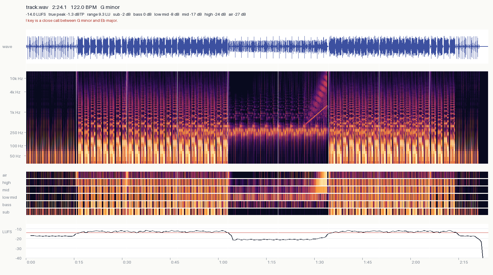

# music-skill

A [Claude Code](https://claude.com/claude-code) skill for making, checking and understanding music
from a terminal, written for an agent that **can't hear**. Every step turns music into something a
model can read: patterns as text, numbers to check, and one picture to look at.



*`listen.py look --sheet` on a track this skill made from seed 4242: waveform, spectrogram, six
band lanes and loudness. The breakdown at 1:03 is the dark gap where the kick and bass drop out,
and the diagonal line before 1:34 is the riser into the second drop. Hear it:
[docs/banger-4242.m4a](docs/banger-4242.m4a) (MIDI: [docs/banger-4242.mid](docs/banger-4242.mid)).*

Heavily inspired by [Banger Lab](https://claude.ai/artifact/N6bSgS4ZH5ifFQfg8sm4dv), a page that
builds a house track in your browser one instrument at a time. This is that method as a command:
my own code, the same idea and the same sources.

## What it does

- **Writes a track by search, not by a model.** A seed rolls a style, tempo and key. Each
  instrument starts as a random 16-step pattern, and the search keeps the one-step change that
  best fits a short list of rules from rhythm and pitch research (kick on every beat, medium
  syncopation, bass out of the kick's way, voices moving the shortest distance). Then it renders
  each part alone, measures its spectrum, and re-tunes the parts so they don't fill the same band
  on the same step.
- **Renders it**: a small synth in numpy (kick, clap, hats, percussion, bass, chords, lead,
  risers), sidechain, reverb, delay, and a master to a loudness target. 72 bars in about 10 s.
- **Fits a brief**: `--seconds 30` lands on 30.0 s, `--key A --bpm 124`, `--lufs -22 --mute lead`
  for a bed under a voice, `--stems`, and always a MIDI file.
- **Listens to anything**: `listen.py look` gives tempo, key, loudness, true peak, balance, stereo
  width and a timeline that shows the intro, breakdown and drop. `check` passes or fails a file
  against targets. `mix` shows which stems cover each other.

## Install

```bash
git clone https://github.com/kylefritz/music-skill ~/code/music-skill
ln -s ~/code/music-skill ~/.claude/skills/music-skill
```

Needs [uv](https://docs.astral.sh/uv/) and ffmpeg. Then ask Claude:

- "make me a 30 second deep house bed for this video, quiet enough to talk over"
- "make a peak-time techno track in A minor and give me the stems"
- "what's the BPM and key of this mp3? where's the drop?"
- "is this loud enough for Spotify? will it clip?"

## Make one

```text
$ uv run --no-project --with numpy --with scipy python scripts/banger.py --seed 4242 --out b4242
seed 4242  Melodic techno  122 BPM  G minor  swing 1%  chords: pluck
timing ms: hat +5  clap -5  perc +4  bass +4

       1...2...3...4...   (. rest, o soft, x medium, X loud; bass R root 5 fifth O octave 3 third;
                           lead = scale degree 0-9 over two bars)
kick   X...X...X.X.X...
clap   .o..X.......X...
hat    x.X...X.x.X...X.
ohat   ..X...X...X...X.
perc   o.X..ox......X..
bass   .....ORO.O.O3RRR
chords ...X............  i7 Gm7 | bVII7 F7 | bVI7 Ebmaj7 | iv7 Cm7
lead   47244.42.22..442 .3315.553.5.3557

kick   fit 100%    674 patterns tried
clap   fit 100%   1268 patterns tried
hat    fit  79%   2351 patterns tried   weakest: Evenly spread 67%, Clear mix 4%
ohat   fit  93%    442 patterns tried
perc   fit  74%   1293 patterns tried   weakest: Evenly spread 52%, Clear mix 20%
bass   fit  92%   1987 patterns tried
chords fit  91%   2253 patterns tried   weakest: Clear mix 50%
lead   fit  89%  25457 patterns tried   weakest: Clear mix 26%

arrangement: 72 bars  Intro 0s  Groove 16s  Drop A 31s  Break 63s  Build 79s  Drop B 94s  Outro 126s
track.wav  144.1s  -14.0 LUFS  true peak -1.3 dBTP  limiter took off up to 0.3 dB
made in 10s: banger.py --seed 4242 --out b4242
```

The agent reads that score before anything else: four-on-the-floor with one pickup kick, claps on
2 and 4 with a ghost, bass that mostly plays between the kicks, and a i-VII-VI-iv loop in G minor.
`python3 scripts/groove.py --seed N` prints the same thing in half a second with no audio, which
is how it auditions seeds.

## Listen to one

```text
$ uv run --no-project --with numpy --with scipy --with pillow python -I scripts/listen.py look b4242/track.wav
track.wav  2:24.1  122.0 BPM (strength 7.9)  G minor (score 1.62; next Eb major 1.61)
  loudness -14.0 LUFS  true peak -1.3 dBTP  range 9.3 LU  peak-to-loudness 12.7 dB
  balance, dB under the loudest band  sub -2  bass 0  low mid -8  mid -17  high -24  air -27
  stereo  correlation 1.0  under 120 Hz 1.0  side is -32.9 dB vs mid

  timeline, 15.7 s windows (8 bars): loudness, then each band in dB against its level over the whole track
    start     LUFS        sub    bass low mid     mid    high     air
     0:00.0   -17.1         -6      -2      -9     -16      -8      -3
     0:15.7   -12.4         +2      +2      -0      +2      +1      -0
     0:31.5   -12.5         +2      +2      +0      +2      +1      -1
     0:47.2   -12.6         +2      +2      +1      +2      +1      -2
     1:03.0   -21.1        -29     -12      +1      -7      -7      -6
     1:18.7   -20.5        -33     -12      +1      -1      +3      +6
     1:34.4   -12.6         +2      +2      +1      +2      +1      -0
     1:50.2   -12.6         +2      +2      +1      +2      +1      -2
     2:05.9   -14.0         -0      +0      -3      -2      -2      -1
  ! key is a close call between G minor and Eb major.
```

The breakdown is the row where sub falls 29 dB. `look` reads anything ffmpeg can decode, so it's
also the first thing to run on music from a generative model: the one bed I pointed it at came
back with a +3.2 dBTP true peak and 2,121 clipped samples.

## The rules, and where they come from

| Rule | Source |
|---|---|
| Kick on every beat, claps on 2 and 4, hats between the kicks, layers that enter and leave in sections | Butler 2006, *Unlocking the Groove* |
| Medium syncopation gives the strongest wish to move | [Witek et al. 2014](https://doi.org/10.1371/journal.pone.0094446) |
| Spread hits as evenly as the grid allows | [Toussaint 2005](https://cgm.cs.mcgill.ca/~godfried/publications/banff.pdf) |
| The home note and its chord are heard as most stable: start there, bass on the root | Krumhansl & Kessler 1982 |
| Move each voice of a chord the shortest way to the next | Tymoczko 2011, *A Geometry of Music* |
| Small melodic steps are heard as one line | [Huron 2001](https://doi.org/10.1525/mp.2001.19.1.1) |
| Two sounds in one narrow band interfere: keep bass off the kick and parts out of each other's bands | [Plomp & Levelt 1965](https://pubmed.ncbi.nlm.nih.gov/5831012/) |
| A two-bar melody asks, then answers | Caplin 1998, *Classical Form* |
| Keep timing shifts small (here under 12 ms): larger ones lowered groove ratings | Davies et al. 2013 |
| Breakdown, build-up, drop | [Solberg & Dibben 2019](https://eprints.whiterose.ac.uk/id/eprint/145911/) |
| The strong/weak beat grid; the syncopation count | Lerdahl & Jackendoff 1983; Longuet-Higgins & Lee 1984 |

The weights between rules are a simplification and aren't fitted to listening data.

## Numbers this skill was built on

All measured on an M4 Mac mini.

| What | Result |
|---|---|
| A 72-bar track (2:24), search to mastered WAV | 10 s |
| The search alone | ~26,500 patterns scored per track, 0.5 s |
| One random start per layer vs four | percussion ended far from its target count in 11 of 100 seeds vs 1 of 100; worst hat fit 0.70 → 0.92 |
| What the second pass costs the first-pass rules | little: percussion syncopation 0.98 → 0.90, chord rhythm 0.98 → 0.94, the rest within 0.03 |
| Tempo detection, 24 rendered tracks with known BPM | 24 of 24 within 0.2 BPM |
| Key detection, same 24 | home note right in 19 (14 with Krumhansl-Kessler profiles alone; the bass vote adds 5) |
| Loudness, range and true peak vs `ffmpeg ebur128` | same to 0.1 LU / 0.1 dB on a rendered track and a model-generated bed |
| `--seconds 30` | 14 bars at 122.18 BPM, 30.0 s |

## What's in here

| File | What it does |
|---|---|
| `SKILL.md` | the instructions Claude follows |
| `scripts/groove.py` | the composer: genome, rules, search, arrangement. Standard library only |
| `scripts/banger.py` | the synth, the listening step, the mix and master, MIDI and WAV out |
| `scripts/listen.py` | `look`, `check`, `mix` and the sheet |
| `scripts/audio.py` | BS.1770 loudness, true peak, band energy |

## TODO

- the mix is dark and narrow next to a mastered release (mids 17 dB under the bass, hats 40 dB
  under it). Levels follow Banger Lab's; they want a pass against reference tracks
- fit the rule weights to something: right now they're a guess
- key detection can't tell dorian or phrygian from minor
- more than four-on-the-floor

## License

MIT. See [LICENSE](LICENSE). Tracks you make with it are yours: no samples, no model weights.
